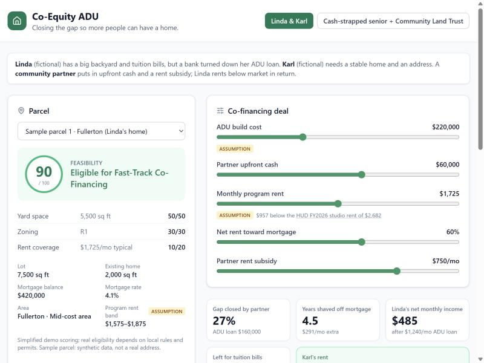

# Co-Equity ADU

> For a homeowner with a backyard, a tenant who needs an affordable home, and the community partner
> who brings them together: a calculator and AI-drafted term sheet that show how a shared deal closes
> the ADU financing gap.

**Team:** NeighborNest
**Members:** [names]
**Lane:** 3 Fund it (with a Lane 2 angle: a homeowner adding an ADU)
**Built at:** Claude Impact Lab: UCI × SoCal Affordable Housing, November 7, 2026

## The problem

Orange County has room for more homes in its own backyards, but the money rarely lines up. A
homeowner with a big lot may have equity but too little cash or income to qualify for an ADU loan.
Someone who needs a home can't pay market rent. HUD's FY2026 Fair Market Rent for a studio in
Orange County is $2,682 a month. A community partner (a nonprofit, land trust or rental-assistance
program) can close the gap, but working out who pays what, and whether it pencils, is done by hand
one deal at a time.

## The people (fictional)

Linda and Karl are **fictional composite personas**. No real people are described here.

| | Before | After (default "Linda & Karl" scenario) |
|---|---|---|
| **Linda**, homeowner in Fullerton | Two kids at private universities, tuition due. A bank turned down her ADU loan: her cash and income are too tight today. | A partner's $60,000 upfront cuts her ADU loan to $160,000. After the loan payment she nets $485 a month: $291 goes to her mortgage (paid off about 4.5 years sooner) and $194 to tuition. |
| **Karl**, living unhoused | Wants any stable home, an address for job applications and a place to receive packages. | Rents the ADU for $975 a month after a $750 partner subsidy: 33% of his income, within the 30-35% affordability guideline. Has an address. |
| **Community partner** | Has funds but no quick way to size a deal. | Sees the gap it closes (27% of the build), the subsidy it commits, and a draft term sheet to start the conversation. |

In return for the partner's upfront cash, Linda rents below market: $1,725 a month, $957 under the
HUD studio rent.

## What we built



A single-page app:

- **Parcel and feasibility.** Pick one of 8 synthetic Orange County parcels and see a 0-100
  feasibility score (yard space, zoning, rent coverage) with the breakdown.
- **Deal sliders.** Build cost, partner upfront cash, monthly program rent (limited to the area's
  band), share of net rent toward the mortgage, and partner rent subsidy.
- **Metric cards and payoff chart.** Gap closed, years shaved off the mortgage, Linda's net
  monthly income, money left for tuition, and Karl's rent as a share of income (color-coded).
  Baseline vs accelerated mortgage payoff.
- **Assumptions and sources panel.** Every number the app did not compute, labelled SOURCE,
  ASSUMPTION or SYNTHETIC, with links and dates.
- **Before / After story** drafted by Claude for Linda and Karl, refreshed as the deal changes.
- **Co-financing term sheet** streamed live from Claude, printable or savable as PDF.
- **Ask the ADU Navigator**: grounded Q&A about the current deal.

**Demo video:** [link, or "uploaded on the hub"]
**Live demo:** [optional]

## How Claude is used

| Where | What Claude does | What keeps it honest |
|---|---|---|
| Term sheet (`POST /api/term-sheet`) | Streams an illustrative, non-binding term sheet in five sections via `client.messages.stream`, rendered live as markdown | Claude only sees numbers the server recomputes from validated inputs. Cut-off drafts are flagged and never cached |
| Before / After story (`POST /api/story`) | Writes structured bullets for Linda and Karl through a `write_story` tool with a strict JSON schema | Schema-checked output; told to avoid pity language and stereotypes; under 18 words per bullet |
| ADU Navigator (`POST /api/ask`) | Answers questions in under 120 words, grounded in the scenario numbers and `server/adu-rules.md` | Told to say what to confirm and with whom (city planning, a lender, a housing counselor) instead of guessing |
| Guardrails (server) | The API key stays server-side (Express + dotenv). Input validation, a rate limit of 20 Claude calls per minute per IP, a cap of 400 calls per run, and a response cache | Every prompt says: use only the numbers provided; do not invent figures, lender names, laws or fees |
| Building it | The app was built with Claude Code from `master-prompt.md` | The team reviewed the plan, the rent model and the assumptions |

**The numbers never come from the AI.** The calculator (`src/lib/finance.ts`, `src/lib/feasibility.ts`)
computes every figure; Claude only writes around them. The UI says so next to the metric cards and on
every AI output. If live AI is unavailable, the default scenario shows pre-written sample text with a
"Sample output (live AI unavailable)" badge, never presented as live.

Model: `claude-sonnet-5-5` (set once in `server/config.ts`).

## Try it

Needs Node.js 22 (tested on 22.19.0) and npm. An Anthropic API key is optional: without one the
calculator works fully and the AI panels show sample output for the default scenario.

```bash
git clone [repo URL]
cd [repo folder]
npm install
cp .env.example .env
```

Open `.env` and set `ANTHROPIC_API_KEY=` to your key. (On Windows PowerShell, use
`Copy-Item .env.example .env` instead of `cp`.) Then:

```bash
npm run dev
```

Open http://localhost:5173. `npm run dev` starts the API server on port 3001 and the Vite app on
5173, which forwards `/api` to the server. `npm run build` type-checks and builds the front end.

No keys are in this repo. `.env` is git-ignored.

## Sources and assumptions

| Item | Source or assumption | Date checked |
|---|---|---|
| Market rent reference, $2,682/month (studio) | SOURCE: [HUD FY2026 Fair Market Rent, Santa Ana-Anaheim-Irvine HUD Metro FMR Area (all of Orange County)](https://www.huduser.gov/portal/datasets/fmr/fmrs/FY2026_code/2026summary.odn?&year=2026&fmrtype=Final&selection_type=county&fips=0605999999). HUD has also published FY2027 FMRs, which we could not read; this figure may be out of date | 2026-11-07 |
| Karl's income, $2,929/month | ASSUMPTION: full time (40 h × 52 weeks) at the 2026 California minimum wage of $16.90/hour ([DIR release 2025-118](https://www.dir.ca.gov/DIRNews/2025/2025-118.html)) | 2026-11-07 |
| Program rent bands | ASSUMPTION: 62-75% (higher-cost area), 58-70% (mid), 55-66% (lower) of the HUD studio rent. City tiers are team judgment | n/a |
| Affordable rent threshold, 35% of income | ASSUMPTION: the event brief's "around 30 to 35 percent" housing-cost guideline (`docs/background.md`), applied to rent | 2026-11-07 |
| ADU loan, 7% over 20 years | ASSUMPTION: rounded from the Freddie Mac 30-year average of 7.18% (week of 2026-11-05) listed in `lanes/3-fund-it/data/DATA-SOURCES.md`; not checked independently | n/a |
| Build cost range, $150,000-$350,000 | ASSUMPTION: no current, free Orange County ADU cost source was verified | n/a |
| Mortgage years remaining, 25 | ASSUMPTION, same for every sample parcel | n/a |
| Rent subsidy paid to the homeowner on the tenant's behalf | ASSUMPTION: program design | n/a |
| Feasibility scoring (yard 50, zoning 30, rent 20) | ASSUMPTION: simplified demo scoring | n/a |
| ADU rules for the Navigator | `server/adu-rules.md`: a simplified placeholder. State rules per the [HCD ADU Handbook (March 2026)](https://www.hcd.ca.gov/sites/default/files/docs/policy-and-research/adu-handbook-update.pdf), as listed in `docs/background.md`; not read in full by us | 2026-11-07 |
| Parcels, mortgages, Linda and Karl | SYNTHETIC: made up for the demo. Real city names only | n/a |

Every made-up number is labelled ASSUMPTION here and in the app's "Assumptions and sources" panel.

## What is real and what is mocked

| Part | Status |
|---|---|
| Feasibility and finance calculators | Working (deterministic, run in the browser and re-run on the server) |
| Live Claude term sheet, story and Navigator | Working (needs an API key) |
| Sample output when AI is unavailable | Working, default scenario only, always badged |
| HUD market rent | Real, FY2026 (may be stale) |
| Parcels, mortgages, people | Mocked (synthetic) |
| Program rent bands and city tiers | Assumed |
| ADU rules | Placeholder summary, not a rules engine |

## Where it gets things wrong

- **The feasibility score is a toy.** It ignores setbacks, height limits, fire and flood zones,
  utilities, HOA rules and each city's ADU ordinance.
- **Rents are one county-wide number with guessed area tiers.** Real rents vary by ZIP code and
  unit size.
- **The cash flow is simplified.** It leaves out property tax changes, insurance, maintenance,
  vacancy and utilities. It does not model how long the subsidy lasts or what happens when it ends.
- **Loan terms are assumed.** A real lender may not offer 7% over 20 years, or may not lend at all.
- **Claude can still be wrong in its wording.** The metric cards are the source of truth. We would
  not trust the term sheet or Navigator for any real decision without a lender, the city and a
  housing counselor.
- **Unknown:** whether any lender or partner would accept this structure. We have not asked one.

## Next steps

What it would take for a nonprofit or city to use this next month:

1. **Real parcels.** Pull lot and building data from the OC parcel and SCAG zoning layers listed in
   `lanes/1-find-it/data/DATA-SOURCES.md`, in place of the synthetic set.
2. **Better rent data.** Replace the city tiers with HUD Small Area FMRs by ZIP, and move to the
   FY2027 figures.
3. **City rules.** Link each city's ADU checklist and fees (`lanes/2-clear-it/data/oc-cities.json`).
4. **A real partner and lender.** Test the structure with a community land trust or a CDFI lender,
   and model the subsidy term and an exit.

With one more week we would add all of the above for two or three cities and test the term sheet
with a practitioner.

## Data and privacy

This project uses only public or provided data. It contains no personal information about real
tenants, buyers or residents. Parcels and people are synthetic. It does not file applications or
contact any city or person. It is a prototype, not legal, financial or lending advice.

## License

Code: MIT, copyright 2026 NeighborNest; see the LICENSE file in this repo. The challenge brief,
lane descriptions and glossary text (`docs/`, `lanes/`, `templates/`) come from the event's
[starter repo](https://github.com/travcjohnson/claude-impact-lab-uci) and stay under CC0 1.0.
