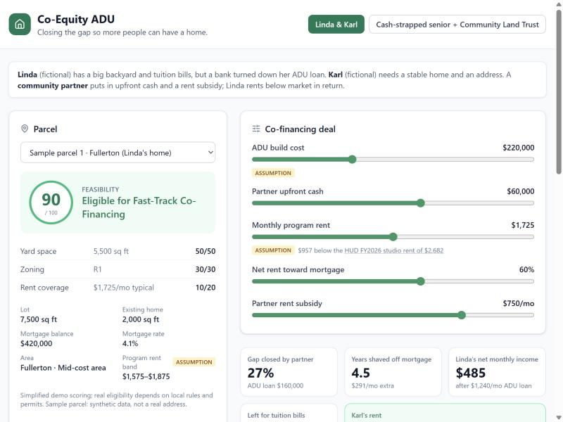
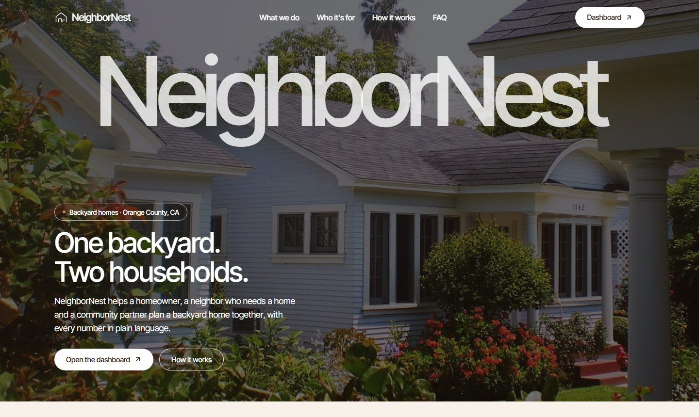

# NeighborNest

> For a community land trust or nonprofit housing program in Orange County: a dashboard that shows
> whether a backyard home (ADU) deal works for the homeowner, the renter and the partner, and drafts
> one plain-language term sheet all three can read.

**Team:** NeighborNest
**Members:** Elijah Smith, Elysia Trocio, Piyush
**Lane:** 3 Fund it (with a Lane 2 angle: a homeowner adding an ADU)
**Built at:** Claude Impact Lab: UCI × SoCal Affordable Housing, November 7, 2026

## The real user

The first user we built for is a program manager at an Orange County community land trust or
nonprofit housing program that helps fund backyard homes rented below market. For each deal they
have to work out how much upfront cash and monthly rent subsidy makes the numbers work for two
households at once: a homeowner whose bank said no to an ADU loan, and a renter who can only pay a
share of a low income. Then they have to explain the same deal to both households in words each can
trust, and start over for the next parcel.

**Before:** they piece each deal together by hand: look up market rent, estimate a loan payment, try
different amounts of partner cash and subsidy, and write up terms for the homeowner and the renter
separately.
**After:** they pick a parcel and set five sliders on the dashboard. The calculator shows at once
whether the deal works for all three (the share of the build the partner covers, the homeowner's
net monthly income and faster mortgage payoff, and the renter's rent as a share of income), with
every source and assumption on screen. Claude then drafts one illustrative term sheet from those
exact numbers, ready to print and use to start the conversation with both households.

We have not yet tested this with a program manager. The "before" is our understanding from the
event brief, not from an interview.

### Example scenario (fictional)

Linda and Karl are **fictional composite personas** used to demo the tool. No real people are
described here. They load from the "Situation example" button on the dashboard.

| | Before | After (the "Linda & Karl" example) |
|---|---|---|
| **Linda**, homeowner in Fullerton | Has room for a backyard home, but a bank turned down her ADU loan: her cash and income are too tight today. | A partner's $60,000 upfront cuts her ADU loan to $160,000. After the loan payment she nets $485 a month: $291 goes to her mortgage (paid off about 4.5 years sooner) and $194 is hers to keep. |
| **Karl**, looking for a stable home | Has been without stable housing; wants a home and an address for job applications and deliveries. | Rents the ADU for $975 a month after a $750 partner subsidy: 33% of his income, under the 35% target. Has an address. |
| **Community partner** | Has funds but no quick way to size a deal. | Sees the gap it closes (27% of the build), the subsidy it commits, and a draft term sheet to start the conversation. |

In return for the partner's upfront cash, Linda rents below market: $1,725 a month, $957 under the
HUD studio rent.

## What we built



A landing page and a **dashboard** (`/dashboard`).

- **Parcel and feasibility.** Pick one of 8 synthetic Orange County parcels and see a 0-100
  feasibility score (yard space, zoning, rent coverage) with the breakdown.
- **Deal sliders.** Build cost, partner upfront cash, monthly program rent (kept inside the area's
  band), share of net rent toward the mortgage, and partner rent subsidy.
- **Metric cards and payoff chart.** Gap closed by the partner, years shaved off the mortgage, the
  homeowner's net monthly income, money left for the homeowner, and the renter's rent as a share
  of income. Baseline vs accelerated mortgage payoff.
- **Assumptions and sources panel.** Every number the app did not compute, labelled SOURCE,
  ASSUMPTION or SYNTHETIC, with links and dates.
- **Before / After story** drafted by Claude for both households, refreshed as the deal changes.
- **Co-financing term sheet** streamed live from Claude, printable or savable as PDF.
- **Ask the ADU Navigator**: grounded questions and answers about the current deal.
- **Situation example** button: loads one of two fictional examples. They are demo inputs, not the
  main content.

**What is new:** it treats a backyard home as a three-party deal. The partner's cash buys a
below-market rent, the subsidy keeps that rent within the renter's means, and all three parties see
the same numbers and the same term sheet.

The landing page explains who it is for, how it works and its limits (FAQ). Its nav buttons jump to
each section.



**Demo video:** [link, or "uploaded on the hub"]
**Live demo:** <https://neighbornest-nine.vercel.app> (dashboard at
<https://neighbornest-nine.vercel.app/dashboard>; live AI checked working on 2026-11-07)

## How Claude is used

- **How we built it with Claude.** We built the app in VS Code with Claude Code, in phases. Version 1
  came from [`master-prompt.md`](../master-prompt.md): the scaffold, the calculators, the guarded Claude
  API routes and the first UI. Version 2 followed a phased plan: an audit
  ([`docs/AUDIT.md`](../docs/AUDIT.md), which found the Vercel deployment was serving no API), a design
  system, routing, the landing page and the dashboard. Claude Code also checked colour contrast
  numerically, found free-license photos through the Wikimedia Commons API and recorded each
  licence, and screenshotted every page at desktop and phone (375 px) widths to check the layout. The
  team chose the scope, the rent model, the assumptions and the design direction, and reviewed each
  phase before the next one.
- **What Claude does inside the tool when it runs, and what a person checks:**

| Where | What Claude does | What keeps it honest |
|---|---|---|
| Term sheet (`POST /api/term-sheet`) | Streams an illustrative, non-binding term sheet in five sections, rendered live as markdown | Claude only sees numbers the server recomputes from validated inputs. Cut-off drafts are flagged and never cached |
| Before / After story (`POST /api/story`) | Writes short bullets for the homeowner and the renter through a `write_story` tool with a strict JSON schema | Schema-checked output; told to avoid pity language and stereotypes; under 18 words per bullet |
| ADU Navigator (`POST /api/ask`) | Answers questions in under 120 words, grounded in the scenario numbers and `server/adu-rules.md` | Told to say what to confirm and with whom (city planning, a lender, a housing counselor) instead of guessing |
| Guardrails (server) | The API key stays server-side. Input validation, 20 Claude calls per minute per IP, a cap of 400 calls per server run, and a response cache | Every prompt says: use only the numbers provided; do not invent figures, lender names, laws or fees |

**What a person checks:** the metric cards are the source of truth. The numbers never come from the
AI: the calculator (`src/lib/finance.ts`, `src/lib/feasibility.ts`) computes every figure, and
Claude only writes around them. Before using a term sheet, a person compares its figures with the
metric cards, and confirms the deal with a lender, the city and a housing counselor. Every AI output
is labelled "Drafted by Claude from the calculator's numbers". If live AI is unavailable, the Linda &
Karl example shows pre-written sample text with a "Sample output (live AI unavailable)" badge, never
presented as live.

Model: `claude-sonnet-5-5` (set once in `server/config.ts`).

## Try it

```bash
git clone https://github.com/Esmith1204/NeighborNest.git
cd NeighborNest
npm ci
cp .env.example .env    # optional: then set ANTHROPIC_API_KEY= in .env for live AI
npm run dev
```

Then open <http://localhost:5173> and click **Dashboard** (or go straight to
<http://localhost:5173/dashboard>).

- **Install first:** Git and Node.js 22 or newer, which includes npm. Tested on Node 22.19.0 with
  npm 11.13.0. Every package version is pinned in `package.json` and `package-lock.json`.
- **Windows PowerShell:** use `Copy-Item .env.example .env` instead of `cp`.
- **Environment variable:** `ANTHROPIC_API_KEY` (optional). Without it the calculator works fully,
  the story and term sheet show labelled sample output for the Linda & Karl example, and the
  Navigator says live AI is not configured.
- **What runs:** `npm run dev` starts the API server on port 3001 and the web app on port 5173,
  which forwards `/api` to the server. `npm run build` type-checks and builds the web app.
- **Data:** the synthetic parcels ship in `src/data/parcels.json`, so it runs without any account.
- **Deploying:** `vercel.json` and `api/index.ts` serve the same API as a Vercel function; set
  `ANTHROPIC_API_KEY` in the Vercel project settings.

No keys are in this repo. `.env` is git-ignored; `.env.example` lists only the variable name.

## Sources and assumptions

| Item | Source or assumption | Date checked |
|---|---|---|
| Market rent reference, $2,682/month (studio) | SOURCE: [HUD FY2026 Fair Market Rent, Santa Ana-Anaheim-Irvine HUD Metro FMR Area (all of Orange County)](https://www.huduser.gov/portal/datasets/fmr/fmrs/FY2026_code/2026summary.odn?&year=2026&fmrtype=Final&selection_type=county&fips=0605999999). HUD has also published FY2027 FMRs, which we could not read; this figure may be out of date | 2026-11-07 |
| Karl's income, $2,929/month | ASSUMPTION: full time (40 h × 52 weeks) at the 2026 California minimum wage of $16.90/hour ([DIR release 2025-118](https://www.dir.ca.gov/DIRNews/2025/2025-118.html)) | 2026-11-07 |
| Program rent bands | ASSUMPTION: 62-75% (higher-cost area), 58-70% (mid), 55-66% (lower) of the HUD studio rent. City tiers are team judgment | n/a |
| Affordable rent threshold, 35% of income | ASSUMPTION: the top of the event brief's "around 30 to 35 percent" housing-cost guideline (`docs/background.md`), applied to rent. Over 50% is shown as severe | 2026-11-07 |
| ADU loan, 7% over 20 years | ASSUMPTION: rounded from the Freddie Mac 30-year average of 7.18% (week of 2026-11-05) listed in `../lanes/3-fund-it/data/DATA-SOURCES.md`; not checked independently | n/a |
| Build cost range, $150,000-$350,000 | ASSUMPTION: no current, free Orange County ADU cost source was verified | n/a |
| Mortgage years remaining, 25 | ASSUMPTION, same for every sample parcel | n/a |
| Rent subsidy paid to the homeowner on the renter's behalf | ASSUMPTION: program design | n/a |
| Feasibility scoring (yard 50, zoning 30, rent 20) | ASSUMPTION: simplified demo scoring. Yard: 0 points under 800 sq ft of yard, 30 at 800 rising evenly to 50 at 1,600+. Zoning: 30, or 10 if Historic. Rent: a year of typical area rent against a $250,000 build, full points at 16% | n/a |
| Example deals (build cost, partner cash, rent, subsidy, paydown share) | SYNTHETIC: Linda & Karl use $220,000 / $60,000 / $1,725 / $750 / 60%; the senior + land trust example uses $180,000 / $100,000 / $1,550 / $600 / 40%. Chosen so the renter pays 30-35% of income | n/a |
| Parcels, mortgages, Linda and Karl | SYNTHETIC: made up for the demo. Real city names only | n/a |
| ADU rules for the Navigator | `server/adu-rules.md`: a simplified placeholder. State rules per the [HCD ADU Handbook (March 2026)](https://www.hcd.ca.gov/sites/default/files/docs/policy-and-research/adu-handbook-update.pdf), as listed in `docs/background.md`; not read in full by us | 2026-11-07 |
| Photos | Six free-license photos from Wikimedia Commons (CC BY / CC BY-SA), downloaded once, resized, camera metadata stripped. They illustrate the idea; they are not the sample parcels. Author, licence and source page for each are in [`public/images/README.md`](../public/images/README.md) and the site footer | 2026-11-07 |

Every made-up number is labelled ASSUMPTION or SYNTHETIC here and in the app's "Assumptions and
sources" panel.

## What is real and what is mocked

| Part | Status |
|---|---|
| Feasibility and finance calculators | Working (deterministic, run in the browser and re-run on the server) |
| Landing page and dashboard | Working, desktop and phone |
| Live Claude term sheet, story and Navigator | Working with an API key |
| Sample output when AI is unavailable | Working for the Linda & Karl example only, always badged; the Navigator has no sample answers |
| Vercel deployment | Working: web app and live AI (checked 2026-11-07) |
| HUD market rent | Real, FY2026 (may be out of date) |
| Photos | Real, free-license, illustrative only |
| Parcels, mortgages, people, example deals | Mocked (synthetic) |
| Program rent bands, city tiers, loan terms, build costs | Assumed |
| ADU rules | Placeholder summary, not a rules engine |

## Where it gets things wrong

- **It has not been run on a real, public parcel.** Every parcel is synthetic. We would not trust
  its score or numbers for a real lot until it uses the county's parcel and zoning data.
- **The feasibility score is a toy.** It ignores setbacks, height limits, fire and flood zones,
  utilities, HOA rules and each city's ADU ordinance. Its thresholds are team judgment.
- **Rents are one county-wide number with guessed area tiers.** Real rents vary by ZIP code and
  unit size.
- **The cash flow is simplified.** It leaves out property tax changes, insurance, maintenance,
  vacancy and utilities. It does not model how long the subsidy lasts or what happens when it ends.
- **Loan terms are assumed.** A real lender may not offer 7% over 20 years, or may not lend at all.
- **The affordability line is the top of a range.** We use 35% of income; many programs use 30%.
  A deal that passes here can still be too expensive under a stricter program rule.
- **Claude can still be wrong in its wording.** The metric cards are the source of truth. We would
  not trust the term sheet or Navigator for any real decision without a lender, the city and a
  housing counselor.
- **Unknown:** whether any lender or partner would accept this structure. We have not asked one.

## Next steps

What it would take for a nonprofit or city to use this next month:

1. **Real parcels.** Pull lot and building data from the OC parcel and SCAG zoning layers listed in
   `lanes/1-find-it/data/DATA-SOURCES.md`, in place of the synthetic set, and run it on one
   publicly listed lot first.
2. **Better rent data.** Replace the city tiers with HUD Small Area FMRs by ZIP, and move to the
   FY2027 figures.
3. **City rules.** Link each city's ADU checklist and fees (`lanes/2-clear-it/data/oc-cities.json`).
4. **A real partner and lender.** Test the structure with a community land trust or a CDFI lender,
   and model the subsidy term and an exit.

**The path to the next 100 projects:** the calculator, the term sheet and the guardrails do not
change from deal to deal; only the parcel data, the rent data and each city's rules do. Once those
come from county and HUD datasets instead of hand-entered samples, one program manager can screen
many parcels, keep the ones that pass, and hand each pair of households the same kind of term sheet.

With one more week we would add steps 1-3 for two or three cities, add sample answers for the
Navigator, and test the term sheet with a practitioner.

## Data and privacy

This project uses only public or provided data. It contains no personal information about real
tenants, buyers or residents. Parcels and people are synthetic, and the photos show no identifiable
people. It does not file applications or contact any city or person. It is a prototype, not legal,
financial or lending advice.

## License

Code: MIT, copyright 2026 NeighborNest; see the LICENSE file at the root of this repo. The challenge brief,
lane descriptions and glossary text (`docs/`, `lanes/`, `templates/`) come from the event's
[starter repo](https://github.com/travcjohnson/claude-impact-lab-uci) and stay under CC0 1.0.
Photos keep their own licences (CC BY / CC BY-SA); see
[`public/images/README.md`](../public/images/README.md).
